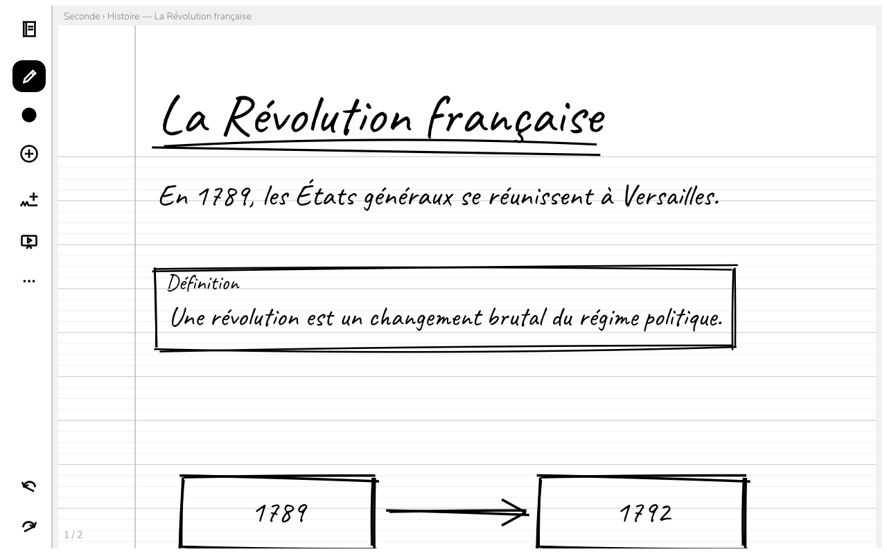
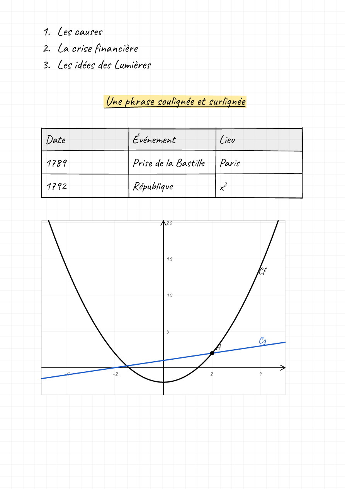

<p align="center"></p>

<h1 align="center">Fanoratana</h1>

<p align="center"><b>On écrit son cours à la main, il se met au propre.</b><br>
Pour les enseignants de toutes les matières. Linux et tablettes Android. Libre, sans compte, hors ligne.</p>

<p align="center">
  <a href="https://github.com/raantss18/Fanoratana/releases/latest/download/fanoratana-arm64-v8a.apk"><b>Télécharger pour Android</b></a> ·
  <a href="https://github.com/raantss18/Fanoratana/releases/latest/download/fanoratana-linux-x86_64"><b>pour Linux</b></a> ·
  <a href="https://github.com/raantss18/Fanoratana/releases/latest">Notes de version</a>
</p>

<p align="center"></p>

<p align="center"></p>

*Fanoratana* (malgache) : « ce avec quoi l'on écrit ».

## Ce qu'on peut faire

- **Écrire** au doigt, au stylet ou à la souris, sur des pages de cahier (lignes, carreaux, points ou blanc).
- **Mettre au propre** : après une pause, ce qui est écrit est lu, hors ligne, et réécrit dans une belle écriture manuscrite.
  Toucher un texte montre ce qui a été lu, propose d'autres lectures et permet de corriger **au clavier**.
- **Taper** directement : l'outil Clavier pose un texte où l'on touche ; `$\frac{a}{b}$`, `$x^2$`, `$\sqrt{2}$`, `$\alpha$` s'écrivent en formules.
- **Dessiner net** : avec l'outil Formes (ou en tenant le trait immobile au bout), un trait devient segment, flèche, cercle, triangle,
  rectangle, losange ou polygone, dessiné au trait fait main. Une flèche se fait d'un trait, ou en ajoutant une pointe.
- **Structurer** : titres, encadrés Définition, À retenir, Exemple, Exercice, Citation ; listes à puces ou numérotées, alignement,
  souligné, surligné ; **tableaux** (on écrit à la main dans une case, elle se remplit).
- **Formules et courbes** : une formule écrite à la main est lue en LaTeX (modèle Pix2Text-MFR à télécharger une fois, 117 Mo) ;
  `f(x)=x^2-1`, `y=2x+1`, `A=(1;2)` comme dans GeoGebra, puis « Tracer la courbe ».
- **Gras** : un mot écrit plus épais (stylo plus large ou appui plus fort) est mis au propre en gras.
- **Signer ou dessiner librement** : une signature ou un croquis restent tels quels, ils ne sont jamais pris pour une forme.
- **Organiser** : Mes cours, niveau → chapitre → leçon, dans un dossier ordinaire (façon Obsidian) ; recherche dans tout le texte.
- **Insérer** des images PNG, JPEG ou SVG.
- **Présenter** : chaque page devient une diapo, plein écran (leçons au format diapo 16:9 ou A4).
- **Exporter** en PDF, en images PNG, ou en Markdown pour Obsidian.
- **Effacer** à la gomme, ou en gribouillant sur ce qu'on veut effacer. Tout s'annule.
- **Se mettre à jour** depuis l'app : la nouvelle version est vérifiée (signature) puis installée d'un toucher.

## À savoir (0.0.1)

- **La lecture d'une écriture réelle se trompe souvent.** Le modèle embarqué (PP-OCRv5 latin, 8 Mo) lit très bien une écriture
  régulière, mal une écriture cursive rapide. Sous un seuil de confiance, l'encre reste telle quelle ; le clavier corrige tout.
  La suite (modèle affiné sur des écritures françaises et malgaches) est dans [`docs/TODO.md`](docs/TODO.md).
- **Formules** : lues en LaTeX une fois le modèle téléchargé (Plus › Réglages) ; elles se tapent aussi entre `$…$`. Les commandes de
  construction GeoGebra (Cercle, Segment…) ne sont pas encore reconnues.
- **Vie privée** : aucun compte, aucune pub, aucune télémétrie. Le réseau ne sert qu'à chercher une mise à jour (une fois par jour, réglable).

## Construire

```bash
cargo run --release -p fanoratana        # Linux
scripts/android-build.sh                 # APK arm64 (NDK 28.2, cargo-ndk, JDK 17)
cargo test --workspace                   # tests
```

Organisation et règles : [`CLAUDE.md`](CLAUDE.md). Décisions : [`docs/adr/`](docs/adr). Recherche : [`docs/recherche/`](docs/recherche).

## Licence

GPL-3.0-or-later. Composants tiers (polices OFL, modèle Apache-2.0, code repris de mahay) : [`THIRD_PARTY_LICENSES.md`](THIRD_PARTY_LICENSES.md).
